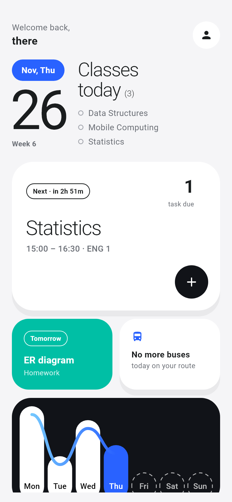
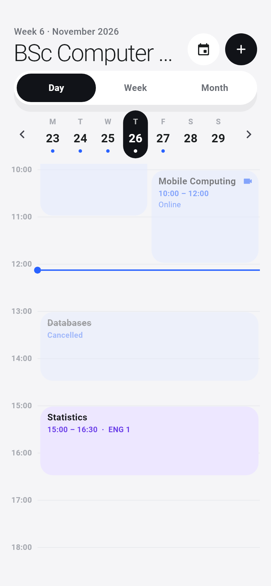
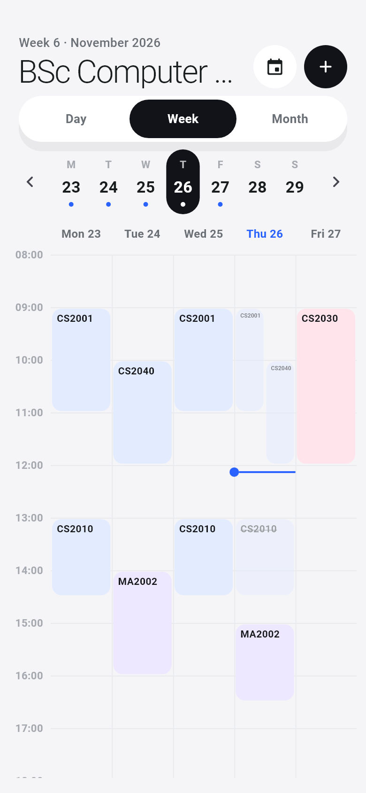
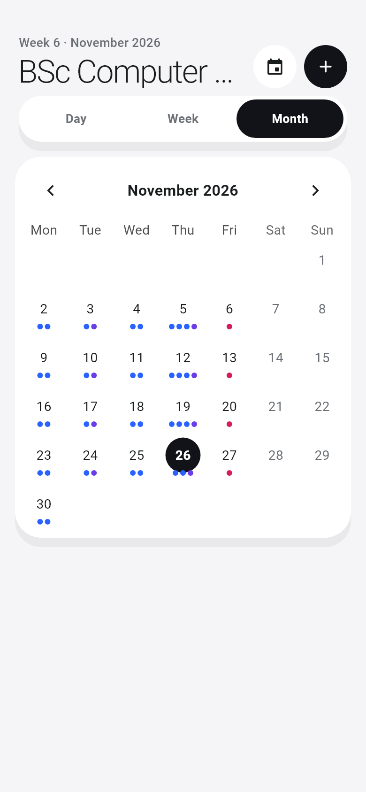
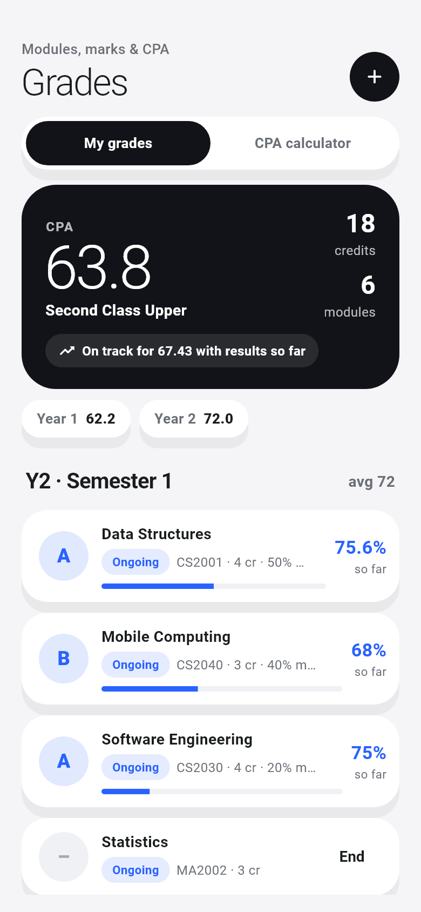
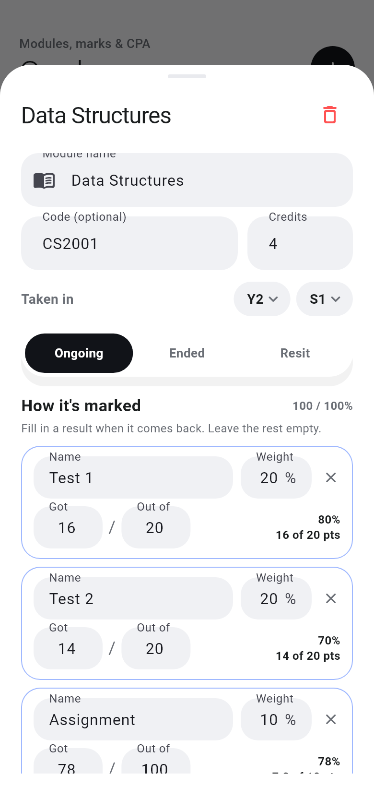
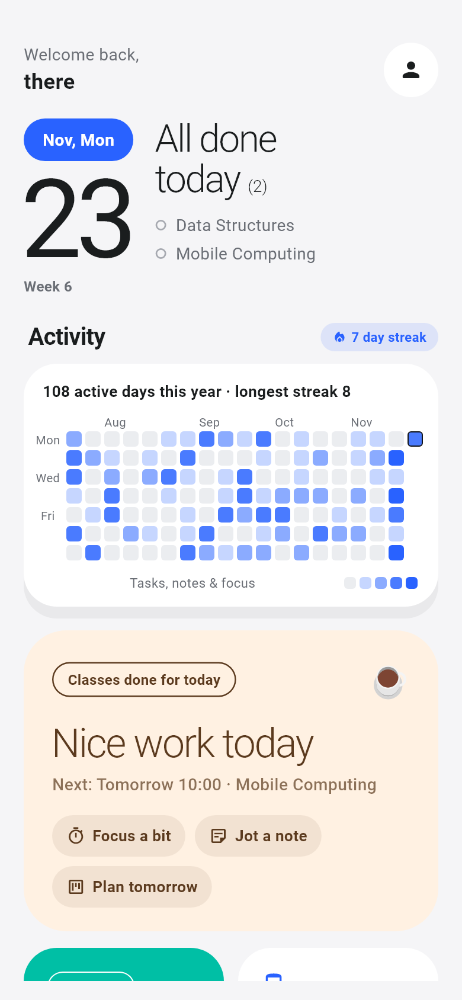
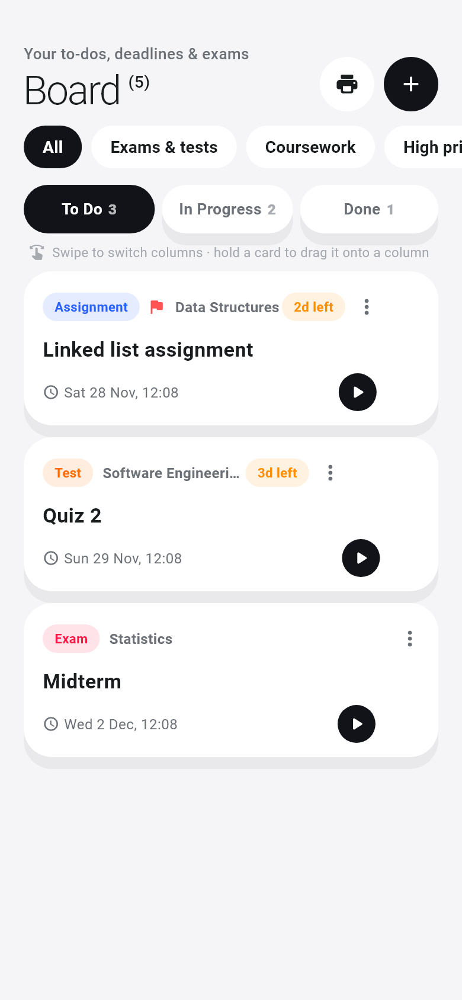
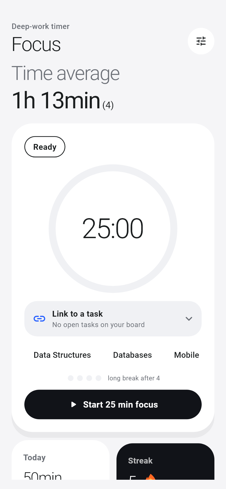

# UOM Personal Student App 🎓

A companion app for University of Mauritius students — timetable, deadlines, bus times, files, focus
timer and study groups — on Android and Windows, synced through one account.

🌐 **Website: [uomper.pages.dev](https://uomper.pages.dev)**

## ⬇️ Download

Grab the latest build from the [**website**](https://uomper.pages.dev/#download) or from [**Releases**](https://github.com/TusharDwarka/UOMPerApp/releases/latest):

- **Android** — `UOMPer-v3.3-android.apk`. Open it on your phone and allow "install unknown apps" when asked.
- **Windows** — `UOMPer-v3.3-windows.zip`. Unzip anywhere and run `uom_per_app.exe` (keep the other files next to it).
  Windows SmartScreen may warn because the app isn't signed: *More info → Run anyway*.

> v3.3 adds how each module is marked (tests, assignments, exam), the mark you need for a pass/C/B/A,
> CPA across every year, and the Activity heatmap on Home.

## 📸 Screenshots

| Home | Day | Week | Month |
|:---:|:---:|:---:|:---:|
|  |  |  |  |

| Grades & CPA | How it's marked | Activity | Board |
|:---:|:---:|:---:|:---:|
|  |  |  |  |

| Focus |
|:---:|
|  |

<sub>Rendered from the real screens with demo data: `flutter test tools/readme_screenshots_test.dart --update-goldens`.</sub>

## ✨ Features

### 📅 Schedule
- AI timetable import (photo/PDF), week-aware classes, one-off classes.
- **Day, Week and Month views**: the day timeline, a Mon–Fri grid of the whole week, and a month calendar (tap a day to open it).
- Day view with correct hour alignment, early/late classes, side-by-side overlapping classes and a live "now" line.
- Tap a class for homework, a reminder and **Join Meet/Teams/Zoom** (paste a link on any class or event).
- **Lecturer cancelled it?** Mark that one class as cancelled — it's crossed out and skipped by reminders, "next class" and
  the widget, on all your devices. Undo from the same sheet.

### 🗓 Academic Hub
- Calendar with **per-event colours** and **multi-day (spanning) events** drawn as continuous bars; finished items turn **green with a tick**.
- **Remind me**: 1 hour / 1–3 days / 1 week before, or any custom time — several per item.
- **Share** an item as a message (WhatsApp…) or post it straight to a study group's calendar.
- Every new task asks **which module it's for** (or *Personal*).
- Day agenda (classes + events), 14-day "coming up" strip.

### ✅ Board (Kanban)
- To Do → In Progress → Done. Drag between columns (PC) or long-press onto a column tab (phone).
- No accidental swipe-to-delete; every delete asks first and offers **Undo**.
- Priority, filters, time spent per task (from Focus), finished items auto-clear after 7/14/30 days.

### 🎓 Grades & modules
- **Grade holder** per year/semester with letter grades, credits and **CPA**.
- **How each module is marked**: add its tests, assignments, class activities and final exam with their weights
  (or pick a template like *2 tests · assignment · exam*), then fill in results as they come back. You see the average so
  far, what you need on the rest for a pass / C / B / A, and the final mark works itself out and goes into your CPA.
- **CPA across every year** (Y1–Y5) with per-year averages and an "on track for" CPA from results so far.
- **CPA calculator**: unfinished modules start on their average so far; try "what if" marks, plan later semesters and
  see the average you need for a target CPA.
- **End a module early** (final test done): two confirmations, confetti, and its classes leave the timetable straight away.
- **Resits**: mark a module for resit, add the resit date (goes to the Hub with reminders); the resit mark replaces the first.

### 🏖 End of semester → holiday mode
- Ending the semester saves your modules to Grades and switches to **holiday mode**: no classes, but calendar, board,
  notes, focus and groups keep working. **Start next semester** when you're ready.

### 🔥 Activity
- A GitHub-style heatmap on Home (in the app's blue): tasks finished, notes written and focus time, with your streak.
  Turn it on/off or move it with *Customise home*.

### 🖨 Print & export
- Task report PDF: pick types, board columns, dates; optional month calendar pages.
- Printable planners: lined / dotted / grid note paper, month calendar, week planner with your classes.
- Built-in PDF viewer for your files.

### 🚌 Bus
- Opens on the **next departure** with a live countdown; earlier buses are collapsed.
- Add a time and it drops into the right slot (arrival pre-filled from the usual journey time); paste many times at once.
- New users start empty: create a route, use a ready-made one, or **import** a route a friend shared (Route menu → Share route sends a code over WhatsApp/group chat).

### 📁 Files
- Module folders + your own folders, with **custom sections** (add / rename / delete). Move, rename, search.
- Saving a shared file, sorting the inbox or moving a file uses one sheet with **folder and section dropdowns** (deleted folders stay hidden).

### 📝 Notes
- Colourful notes with headings, **bold**, bullet lists and tickable checklists; pinning.

### ⏱ Focus
- Pomodoro timer with daily goal, streak and the weekly productivity chart.
- Link a session to a board task, long break every few sessions, and a break reminder after too much continuous focus.

### 👥 Groups
- Join your cohort (public list by programme, year Y1–Y5 and semester S1/S2, or private join code).
- Shared timetable & events managed by **leaders**, group chat with announcements, live "next class" countdown,
  per-member "remind me X min before", and a weekly **focus leaderboard**.
- Shared events carry a **suggested reminder** (e.g. 3 days before); each member can keep it, turn it off or pick their own,
  and gets a heads-up when a new event is posted.

### 🔐 Accounts & sync
- Email/password sign-in (or guest, upgradable later without losing data).
- Everything personal syncs live between phone and PC; the app works offline and catches up later.

## 🔧 One-time Firebase setup

1. Firebase console → **Authentication** → enable **Email/Password** and **Anonymous**.
2. **Firestore Database** → create the database (production mode).
3. Deploy the security rules in this repo:
   ```bash
   npm i -g firebase-tools
   firebase login
   firebase deploy --only firestore:rules
   ```
   Without the rules deployed, Groups will get "permission denied".

## 🚀 Getting started

```bash
flutter pub get
dart run build_runner build --delete-conflicting-outputs   # after changing Isar models
flutter run                 # phone
flutter run -d windows      # PC
flutter test                # logic + layout/overflow tests
```

## 🛠 Tech stack
Flutter · Provider · Isar (local DB) · Firebase Auth + Cloud Firestore (sync & groups) · Gemini (timetable import)

## 🌐 Website

The landing page is in [`website/`](website/): static HTML/CSS/JS with no build step. It's hosted on Cloudflare Pages
at [uomper.pages.dev](https://uomper.pages.dev). Download buttons pick up the newest GitHub release automatically,
so publishing a release doesn't need a redeploy. To publish changes to the site itself:

```bash
npx wrangler@4 pages deploy website --project-name uomper --branch Year2Improvement
```

Pushing to GitHub does **not** redeploy the site.
